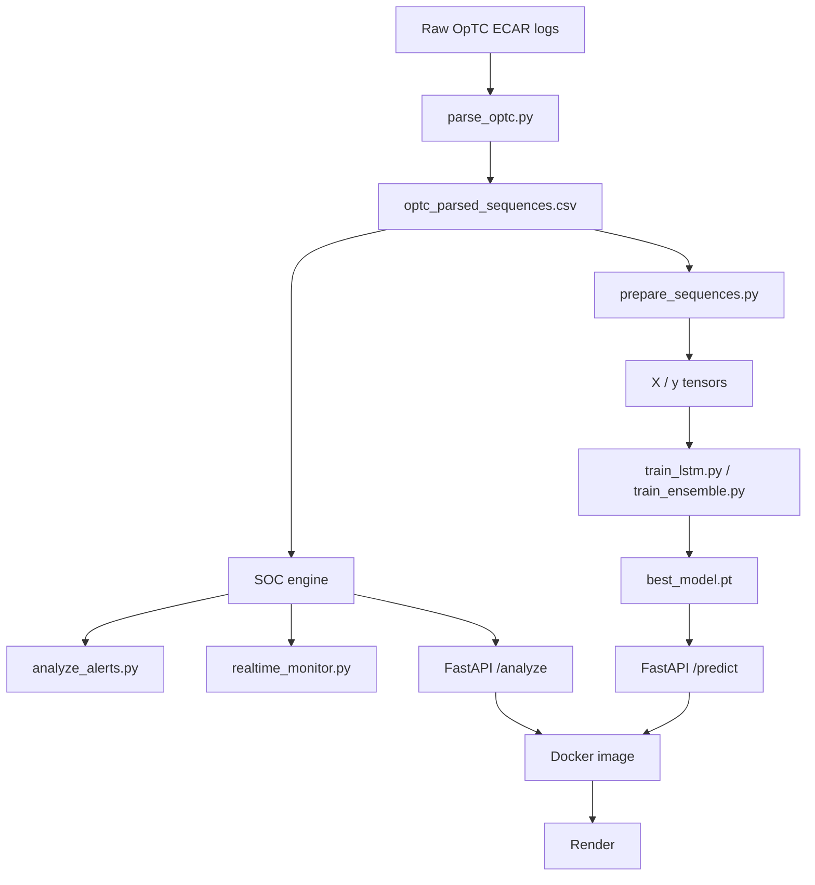

# APT Forecast


APT Forecast reads security event logs and looks for signs of an Advanced Persistent Threat (APT). An APT is a slow, hidden attack. The attacker enters a network, stays hidden, steals credentials, moves between machines, and at the end takes data out.

The project has four parts:

1. An **LSTM model** that scores sequences of events as benign or malicious.
2. A **SOC engine** that turns events into an analyst report: risk score, MITRE ATT&CK mapping, attack timeline, next-stage forecast, and response advice.
3. A **real-time monitor** that watches a growing event file and writes alerts.
4. A **web API** (FastAPI + Docker) that runs on the cloud.

**Live API:** https://apt-forecast.onrender.com
**Test page:** https://apt-forecast.onrender.com/docs

The API runs on the Render free plan. It sleeps when nobody uses it, so the first request can take about a minute.

> **Status: research prototype.** The saved model finds almost no attacks at its default threshold (see [Model results](#model-results)). Do not use this project for real security decisions.

---

## Contents

- [How it works](#how-it-works)
- [Quick start](#quick-start)
- [API reference](#api-reference)
- [SOC engine](#soc-engine)
- [Real-time monitor](#real-time-monitor)
- [Machine learning pipeline](#machine-learning-pipeline)
- [Model results](#model-results)
- [Testing and CI](#testing-and-ci)
- [Deployment](#deployment)
- [Project structure](#project-structure)
- [Limitations](#limitations)
- [Roadmap](#roadmap)

---

## How it works



The model and the SOC engine are separate on purpose. The SOC engine works on event tables. It does not need the model.

---

## Quick start

You need Python 3.10 or newer.

### Run the API on your computer

```bash
git clone https://github.com/himeshsahoo/APT-forecast.git
cd APT-forecast
python -m venv .venv
```

Activate the environment. On Windows PowerShell:

```powershell
.venv\Scripts\Activate.ps1
```

On Linux or macOS:

```bash
source .venv/bin/activate
```

Install and start the API:

```bash
pip install -r requirements-api.txt
uvicorn api.main:app --reload
```

Open http://127.0.0.1:8000/docs.

### Run with Docker

```bash
docker build -t apt-api .
docker run -p 8000:10000 apt-api
```

Open http://127.0.0.1:8000/docs.

### Make an offline SOC report

```bash
pip install -r requirements.txt
python analyze_alerts.py --input optc_parsed_sequences.csv --output soc_report.md --json-output soc_report.json
```

---

## API reference

Base URL: `https://apt-forecast.onrender.com`

| Route | Method | What it does |
| --- | --- | --- |
| `/health` | GET | Returns `{"status": "ok"}`. Used for health checks. |
| `/predict` | POST | Runs the LSTM on one sequence of 10 events. Each event has 5 encoded numbers. |
| `/analyze` | POST | Builds a SOC report from a list of events. |

### `GET /health`

```bash
curl https://apt-forecast.onrender.com/health
```

```json
{"status": "ok"}
```

### `POST /predict`

The input is 10 rows. Each row has 5 numbers: the encoded `action`, `actor_process`, `target_process`, `dest_ip`, and `dest_port`.

```bash
curl -X POST https://apt-forecast.onrender.com/predict \
  -H "Content-Type: application/json" \
  -d '{"sequence": [[1,2,3,4,5],[1,2,3,4,5],[1,2,3,4,5],[1,2,3,4,5],[1,2,3,4,5],[1,2,3,4,5],[1,2,3,4,5],[1,2,3,4,5],[1,2,3,4,5],[1,2,3,4,5]]}'
```

```json
{"malicious_probability": 0.0, "label": 0}
```

A wrong shape returns `422`.

### `POST /analyze`

The input is 1 to 5000 events.

```bash
curl -X POST https://apt-forecast.onrender.com/analyze \
  -H "Content-Type: application/json" \
  -d '{"events": [{"timestamp": "2019-09-23T09:11:03", "hostname": "host1", "action": "FLOW_START", "actor_process": "powershell.exe", "dest_ip": "10.0.0.5", "dest_port": "443", "is_malicious": 1}]}'
```

Short example of the answer:

```json
{
  "executive_summary": "2 malicious events across 1 host(s). Overall risk is 72.3% (High).",
  "risk": {"overall_risk": 72.3, "severity": "High", "alert_count": 2},
  "forecast": {"current_stage": "Execution", "predicted_next_stage": "Privilege Escalation", "probability": 0.87},
  "mitre": [{"id": "T1059", "name": "Command and Scripting Interpreter", "tactic": "Execution", "count": 2}],
  "recommended_responses": [{"action": "Alert administrator", "mode": "recommend"}]
}
```

**Important:** `/analyze` does not run the model. It trusts the `is_malicious` value in each event.

---

## SOC engine

The SOC engine is in `src/apt_forecast/`.

| Module | Purpose |
| --- | --- |
| `soc_engine.py` | Builds the risk score, timeline, forecast, and response advice. |
| `threat_intel.py` | Maps events to MITRE ATT&CK techniques and attack stages. |
| `explainability.py` | Gives rule-based reasons. Has optional SHAP and LIME hooks. |

A report has these parts:

- Executive summary
- Risk score, severity, likelihood, business impact, and confidence
- MITRE ATT&CK techniques with the events that match
- Attack timeline
- Current stage and predicted next stage
- Recommended response actions

The attack stages are, in order: Execution, Credential Dumping, Privilege Escalation, Lateral Movement, Tool Transfer, and Data Exfiltration.

**Safety:** The project never blocks IPs, ends processes, or changes accounts. Every response action is `recommend` (an analyst must do it) or `simulate` (the system only describes it).

---

## Real-time monitor

`realtime_monitor.py` watches an event CSV file that grows over time. It is not an antivirus scan of your computer.

```bash
python realtime_monitor.py --input optc_parsed_sequences.csv --poll-seconds 5
```

Each cycle, the monitor:

1. Reads the last processed row from `monitor_state.json`.
2. Reads only the new rows.
3. Builds a SOC report for them.
4. Writes an alert if the risk is at or above the threshold (default 45).
5. Waits, then repeats.

Useful options:

```bash
python realtime_monitor.py --from-start --once
python realtime_monitor.py --poll-seconds 2
python realtime_monitor.py --risk-threshold 70
```

Output files:

| File | Purpose |
| --- | --- |
| `monitor_state.json` | The last processed row. |
| `alerts.jsonl` | Alert history, one JSON object per line. |
| `latest_soc_report.md` | The newest report. |

---

## Machine learning pipeline

### Data

The data comes from the DARPA Transparent Computing **OpTC** dataset (ECAR logs). `parse_optc.py` turns raw logs into a CSV with these columns:

| Column | Meaning |
| --- | --- |
| `timestamp` | When the event happened |
| `hostname` | The machine |
| `action` | Event type, such as `PROCESS_CREATE` or `FLOW_START` |
| `actor_process` | The process that caused the event |
| `target_process` | The process or file that was affected |
| `dest_ip` | Destination IP for network events |
| `dest_port` | Destination port for network events |
| `is_malicious` | `1` for malicious, `0` for benign |

The labels come from a list of known red-team indicators and compromised hosts in the OpTC ground truth. The raw logs are not in this repository.

The parsed data has about 500,000 events. Only 240 are malicious. The classes are very unbalanced.

### Steps

```bash
python parse_optc.py
python prepare_sequences.py
python train_lstm.py
python train_ensemble.py
python test_model.py
```

| Step | Script | What it does |
| --- | --- | --- |
| 1 | `parse_optc.py` | Reads raw logs. Writes the event CSV with labels. |
| 2 | `prepare_sequences.py` | Groups events by host and time. Makes sequences of 10 events. Splits 80% train and 20% test. |
| 3 | `train_lstm.py` | Trains a bidirectional LSTM (2 layers, 128 hidden units). Saves `best_model.pt`. |
| 4 | `train_ensemble.py` | Trains 3 LSTM models and combines them. |
| 5 | `test_model.py` | Computes ROC-AUC, precision, recall, F1, MCC, and threshold analysis. |

The API uses `best_model.pt` only.

---

## Model results

These numbers are from `test_model.py` on 49,975 held-out sequences. Only 21 of them are malicious (0.04%).

| Metric | Threshold 0.5 | Best-F1 threshold (0.0006) |
| --- | ---: | ---: |
| Accuracy | 99.96% | 90.37% |
| Precision | 0.00% | 0.39% |
| Recall | 0.00% | 90.48% |
| F1 | 0.0000 | 0.0078 |
| ROC-AUC | 0.9391 | 0.9391 |

At threshold 0.5, the model calls every sequence benign. The high accuracy comes only from the class imbalance. At the best-F1 threshold, recall is high but precision is very low, so there are many false alarms.

The model ranks sequences better than random (ROC-AUC about 0.94). But it is not ready for real detection. It needs retraining, better features, and threshold calibration.

The chart is in `model_test_results.png`.

---

## Testing and CI

Run the tests:

```bash
pip install pytest httpx
pytest
```

The tests cover the SOC engine, the real-time monitor, and the API routes. `pytest.ini` sets the import path.

GitHub Actions (`.github/workflows/ci.yml`) runs on each push to `main` and on each pull request:

1. **test:** installs the API dependencies and runs `pytest`.
2. **docker:** builds the Docker image to check that it builds.

---

## Deployment

- The API is in `api/` (FastAPI).
- The `Dockerfile` uses `python:3.11-slim`. It installs the CPU-only version of PyTorch to keep the image small.
- Render builds the image from the `main` branch. It uses `/health` as the health check.
- Render sets the `PORT` variable. The container reads it.

---

## Project structure

| Path | Description |
| --- | --- |
| `api/` | FastAPI service (`main.py`) and model class (`model.py`) |
| `src/apt_forecast/` | SOC engine, MITRE mapping, explanations |
| `tests/` | Unit and API tests |
| `.github/workflows/ci.yml` | CI workflow |
| `Dockerfile`, `.dockerignore` | Container build |
| `requirements-api.txt` | Dependencies for the API |
| `requirements.txt` | Dependencies for training and research |
| `parse_optc.py` | Log parser and indicator-based labeler |
| `prepare_sequences.py` | Sequence builder |
| `train_lstm.py`, `train_ensemble.py` | Model training |
| `test_model.py` | Model evaluation |
| `analyze_alerts.py` | Offline SOC report |
| `realtime_monitor.py` | Real-time monitor |
| `best_model.pt` | Saved model used by the API |
| `docs/PROJECT_REVIEW.md` | Technical review and roadmap |

---

## Limitations

- **The model is weak.** It finds almost no attacks at the default threshold. See [Model results](#model-results).
- **`/predict` needs encoded input.** The label encoders from training are not saved, so the API cannot take raw logs.
- **`/analyze` does not use the model.** It uses the `is_malicious` value in the input.
- **The next-stage forecast is a fixed rule.** It moves one step forward in the stage order. The probability comes from a formula. It is not learned from data.
- **The risk score is a hand-made formula.** It is not calibrated against real incidents.
- **Labels come from known indicators.** The model can learn file names and not attacker behavior.
- **Label encoding treats categories as ordered numbers.** Embeddings or hashing would be better.
- **The data split is random.** A split by time and host would be stricter.
- **Input is a CSV file.** There is no live collector for Sysmon, Zeek, or Windows Event Logs.
- **There is no dashboard and no database.**

---

## Roadmap

**Next**
- Save the label encoders and feature metadata, so `/predict` accepts raw events.
- Split train and test by time and by host.
- Retrain with class weights or sampling, and calibrate the threshold.
- Deploy the same Docker image to Google Cloud Run.

**Later**
- Dashboard with risk cards, timeline, and MITRE view.
- SQLite or PostgreSQL storage for alerts.
- Transformer-based temporal model with categorical embeddings.
- Experiment tracking with MLflow.
- Live log collectors and threat-intelligence enrichment.