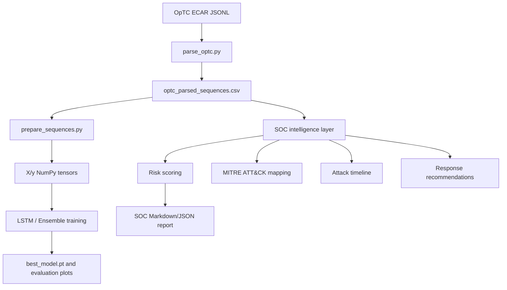

# APT Forecast Project Review and Roadmap

## Folder Structure

```text
apt-forecast-project/
  analyze_alerts.py                 # SOC report CLI
  parse_optc.py                     # OpTC ECAR JSONL parser and IOC labeling
  prepare_sequences.py              # Categorical encoding and sequence tensor builder
  train_lstm.py                     # Bidirectional LSTM training
  train_ensemble.py                 # Three-model LSTM ensemble training/evaluation
  test_model.py                     # Model evaluation and threshold analysis
  inspect_data.py                   # Raw JSON inspection utility
  src/apt_forecast/                 # Analyst-facing SOC intelligence layer
  tests/                            # Regression tests
  *.pt, *.png, *.npy, *.csv         # Generated models, plots, tensors, parsed data
```

## Architecture



## Current Ratings

| Category | Rating | Notes |
| --- | ---: | --- |
| Code quality | 5/10 | Scripts are understandable but flat, duplicated model classes, hard-coded paths. |
| ML pipeline | 6/10 | LSTM and ensemble are useful, but no experiment tracking or config layer. |
| Feature engineering | 4/10 | Label encoding works for a prototype but treats categories as ordinal numbers. |
| Dataset quality | 6/10 | OpTC is credible, but the current parser uses only the first 500k lines. |
| Dataset balance | 3/10 | 240 malicious rows out of 500k parsed events is extremely imbalanced. |
| Generalization | 4/10 | IOC-based labels risk memorizing known strings instead of attacker behavior. |
| Model performance | 6/10 | Good metrics are calculated, but validation strategy is still limited. |
| Explainability | 3/10 | New rule explanations exist; model-level SHAP/LIME hooks are optional. |
| UI/UX | 1/10 | No dashboard yet. Reports are CLI-generated Markdown/JSON. |
| Deployment | 1/10 | No Docker, API server, or service config yet. |
| Documentation | 5/10 | README exists; this review adds architecture and roadmap. |
| Architecture | 4/10 | Training and analysis now begin separating, but no service boundary yet. |
| Testing | 3/10 | New SOC unit test exists; training and parser tests are still needed. |
| Scalability | 4/10 | Pandas loads full CSV; sequence generation is memory-heavy. |
| Cybersecurity practice | 5/10 | Uses IoCs and MITRE mapping, but no live ingestion or safe response policy enforcement yet. |

## Data Flow

1. Raw ECAR JSON lines are parsed into normalized event rows.
2. Parser assigns `is_malicious` using compromised hostnames and known red-team indicators.
3. Sequence builder sorts by host and timestamp, label-encodes categorical features, and creates fixed-length tensors.
4. LSTM or ensemble models train on the tensors.
5. Evaluation scripts compute confusion matrix, ROC-AUC, precision/recall, MCC, threshold analysis, and plots.
6. The new SOC layer reads the parsed CSV directly and emits analyst-facing risk, MITRE, timeline, forecast, and response outputs.

## Main Risks and Recommendations

- Replace label encoding with embeddings or hashing. Plain integer labels impose fake ordering on process names, IPs, and actions.
- Save encoders and metadata. Inference cannot safely process new logs unless the exact training transformations are persisted.
- Move hard-coded paths and hyperparameters into config files.
- Use chronological host-aware splitting. Random sequence splitting can leak neighboring behavior across train/test.
- Add a model registry and experiment tracking with MLflow before comparing many architectures.
- Add a FastAPI service after the SOC report contract stabilizes.
- Keep automated response in recommendation or simulation mode by default. Do not block IPs, kill processes, or disable accounts automatically unless an explicit policy enables it.

## Recommended Model Direction

Use a hybrid architecture:

- Baseline: Random Forest or LightGBM on aggregate host/session features.
- Main temporal model: Transformer encoder with categorical embeddings and temporal attention.
- Anomaly layer: Isolation Forest or autoencoder for unknown behavior.
- Future research: graph neural network over host-process-IP relationships.

This is stronger than a pure LSTM because APT behavior includes long-range relationships, repeated entities, and graph structure.


## Realtime Monitoring Upgrade

`realtime_monitor.py` turns the offline analyzer into a long-running SOC monitor for append-only parsed event logs.

Runtime behavior:

- Polls `optc_parsed_sequences.csv` or another parsed CSV at a configurable interval.
- Tracks the last processed row in `monitor_state.json`.
- Analyzes only newly appended events per cycle.
- Emits alert records to `alerts.jsonl` when risk crosses the configured threshold.
- Updates `latest_soc_report.md` with the newest human-readable incident report.
- Keeps all response actions in recommend/simulate mode.

This is the correct first step toward real-time monitoring because it creates a stable streaming interface without coupling the system to one telemetry source. A Sysmon, Zeek, Suricata, or Windows Event Log collector can later append normalized rows to the same schema or call the SOC engine directly.

## Roadmap

### Version 2.0

- Package the codebase.
- Add SOC report generation, MITRE mapping, risk scoring, attack timeline, and response recommendation.
- Add unit tests for analyst output.

### Version 2.1

- Persist encoders and feature metadata.
- Add SHAP/LIME explanations for tabular baselines and attention summaries for temporal models.
- Add host-aware chronological train/validation/test split.

### Version 2.2

- Add FastAPI inference endpoint.
- Add dashboard with risk cards, timeline, MITRE matrix, alerts, and recommended response actions.

### Version 3.0

- Add Transformer temporal model, MLflow tracking, Docker, CI, and model versioning.

### Version 4.0

- Add real-time ingestion from Sysmon, Zeek, Suricata, or Windows Event Logs.
- Add threat-intel enrichment for IP/domain reputation, CVEs, malware families, and actor profiles.
- Add simulated response orchestration with explicit approval gates.

## Future Research

- Graph neural networks for attack path modeling.
- Federated learning across organizations without sharing raw logs.
- Reinforcement learning for response selection in a cyber range.
- Multi-agent SOC assistants for triage, hunting, forensics, and reporting.
- Zero-day detection with self-supervised sequence modeling.
- Digital twin simulation for testing containment strategies.

